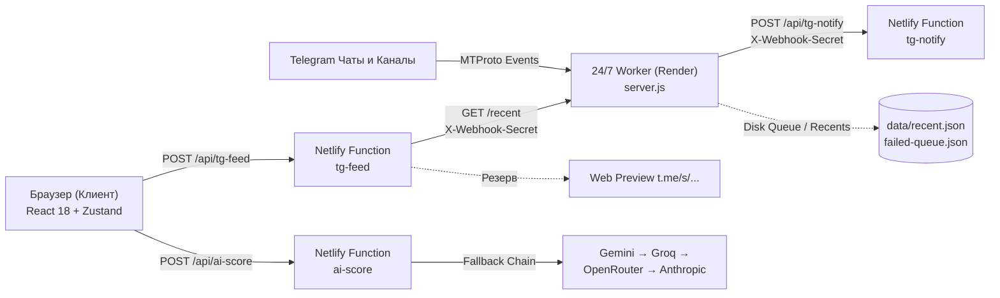

# LeadHunter Monorepo (Web App + 24/7 Telegram Worker)

Репозиторий платформы **LeadHunter** — специализированного сервиса для видеомонтажёров по поиску YouTube-клиентов и мониторингу вакансий в реальном времени.

---

## 🏛 Архитектура системы



```
[ Telegram Channels & Chats ] 
             │
      (MTProto 24/7)
             ▼
[ Render Worker: server.js ] ──(POST /api/tg-notify with X-Webhook-Secret)──► [ Netlify: tg-notify ]
       │            │
 (data/recent.json) │
       │            │
       ▲            ▼
[ Netlify: tg-feed ] ◄──(GET /recent with X-Webhook-Secret)
       ▲
       │
[ Frontend React: /vacancies ]
```

---

## 📁 Структура проекта

```
├── server.js               # 24/7 MTProto Telegram-слушатель (Render Web Service)
├── auth.js                 # Интерактивная генерация SESSION_STRING
├── test/
│   └── worker.test.js      # Юнит-тесты фильтра, парсера бюджета, URL
├── data/                   # Локальное хранилище недавних лидов и очереди повторов
│   ├── recent.json
│   └── failed-queue.json
├── package.json            # Корневой манифест (скрипты lint, test, typecheck, build:all)
├── .env.example            # Шаблон переменных окружения
├── .github/workflows/
│   └── ci.yml              # CI/CD проверка (Node 18/20, lint, typecheck, tests, build)
└── web/                    # Фронтенд и Serverless Functions
    ├── netlify.toml        # Конфигурация Netlify и Security Headers (CSP, HSTS)
    ├── netlify/functions/  # Serverless функции Netlify
    │   ├── _shared/
    │   │   ├── ai.ts       # Мульти-провайдерная AI-цепочка (Gemini → Groq → OpenRouter → Claude)
    │   │   └── response.ts # CORS, IP rate-limiter, 32KB валидатор
    │   ├── tg-feed.ts      # Параллельный опрос воркера и резервный скрейпинг
    │   ├── tg-notify.ts    # Защищённый вебхук приема лидов от воркера
    │   ├── ai-score.ts     # Квалификация YouTube-каналов
    │   ├── ai-rewrite.ts   # Рерайт питчей
    │   ├── youtube-search.ts
    │   └── health.ts       # Проверка статуса провайдеров
    └── src/
        ├── shared/         # Общие модули воркера и фронтенда
        │   ├── keywords.js # Единая база ключевых слов и стоп-фраз
        │   ├── filter.js   # Регулярные выражения с Unicode границами
        │   └── budget.js   # Универсальный парсер бюджета (₽, $, €, ₸)
        ├── pages/          # Страницы (Vacancies, Finder, Leads, Dashboard, NotFound)
        └── store/          # Zustand хранилища с безопасным localStorage
```

---

## ⚙️ Переменные окружения (Environment Variables)

### 1. Telegram Worker (Render.com)

| Переменная | Обязательна | Пример / Описание |
|---|:---:|---|
| `API_ID` | **Да** | `1234567` (Число из my.telegram.org) |
| `API_HASH` | **Да** | `abcdef1234567890abcdef1234567890` (32 hex-символа) |
| `SESSION_STRING` | **Да** | `1BJWap8...` (Строка сессии, генерируется через `npm run auth`) |
| `WEBHOOK_URL` | Нет | `https://fleurleads-work.netlify.app/api/tg-notify` |
| `WEBHOOK_SECRET` | Рекомендуется | `super-secret-random-token` (Защита эндпоинтов `/recent` и вебхука) |
| `ALLOWED_CHATS` | Нет | `work_videoedit,kinovideojob,1234567890` (Белый список каналов/id через запятую) |
| `ALLOWED_CHATS_FILE` | Нет | `/data/allowed-chats.txt` (Путь к файлу со списком чатов, перечитывается каждые 10 минут) |
| `RATE_LIMIT_PER_MINUTE` | Нет | `5` (Макс. количество мгновенных уведомлений в минуту, далее дайджест) |
| `JOIN_DAILY_LIMIT` | Нет | `15` (Суточный лимит вступлений в чаты для `scripts/join-sources.js`) |
| `PORT` | Нет | `8080` (Порт встроенного HTTP сервера) |
| `RENDER_EXTERNAL_URL` | Нет | `https://leadhunter-worker.onrender.com` (Включает самопинг каждые 10 минут) |

> ⚠️ **Внимание об эфемеральном диске Render Free Tier**:
> На бесплатном тарифе Render файловая система контейнера сбрасывается при перезапуске инстанса (файл `data/recent.json` очищается). Для персистентного хранения данных между перезапусками подключите [Render Persistent Disk](https://render.com/docs/disks) к пути `/data` либо внешнюю базу данных.

---

### 2. Веб-приложение (Netlify)

| Переменная | Обязательна | Пример / Описание |
|---|:---:|---|
| `ALLOWED_ORIGIN` | Нет | `https://fleurleads-work.netlify.app` (Ограничение CORS, по умолчанию URL сайта) |
| `WEBHOOK_SECRET` | Рекомендуется | `super-secret-random-token` (Совпадает с секретом воркера) |
| `TG_WORKER_URL` | Нет | `https://leadhunter-worker-uokh.onrender.com` (URL воркера на Render) |
| `GEMINI_API_KEY` | Для AI | Google AI Studio API Key |
| `GEMINI_MODEL` | Нет | `gemini-2.5-flash` (по умолчанию) |
| `GROQ_API_KEY` | Для AI (резерв) | Groq Cloud API Key |
| `GROQ_MODEL` | Нет | `llama-3.3-70b-versatile` (по умолчанию) |
| `OPENROUTER_API_KEY` | Для AI (резерв) | OpenRouter API Key |
| `OPENROUTER_MODEL` | Нет | `meta-llama/llama-3.3-70b-instruct:free` (по умолчанию) |
| `ANTHROPIC_API_KEY` | Для AI (резерв) | Anthropic Claude API Key |
| `ANTHROPIC_MODEL` | Нет | `claude-3-5-haiku-20241022` (по умолчанию) |
| `YOUTUBE_API_KEY` | Для поиска | Google Cloud YouTube Data API v3 |
| `TELEGRAM_BOT_TOKEN` | Для бот-уведомлений | Токен бота из @BotFather |
| `TELEGRAM_CHAT_ID` | Для бот-уведомлений | ID чата для личных уведомлений |

---

## 🔑 Инструкция по перевыпуску Telegram Session String

1. Перейдите на [my.telegram.org](https://my.telegram.org) в раздел **API development tools**.
2. Создайте приложение или скопируйте существующие `api_id` и `api_hash`.
3. В корне репозитория запустите:
   ```bash
   npm run auth
   ```
4. Скрипт запросит номер телефона (в формате `+7...`), код из Telegram и пароль двухфакторной аутентификации (2FA), если он включён.
5. Полученную длинную строку сессии `SESSION_STRING` скопируйте в панель управления **Render.com** (в Environment Variables вашего сервиса).

---

## 🛠 Разработка и тестирование

```bash
# Установка зависимостей в корне и во фронтенде
npm install
npm --prefix web install

# Запуск юнит-тестов (фильтрация, парсинг бюджета, ссылки)
npm test

# Проверка типов TypeScript
npm run typecheck

# Линтинг кода
npm run lint

# Сборка продакшн-бандла фронтенда
npm run build:all
```

---

## 📡 Каталог Telegram-источников (150+ каналов и чатов)

Раздел **/sources** предоставляет проверенную базу Telegram-каналов и сообществ:

- **152 проверенных источника** в 5 категориях:
  - `jobs_video` (42): вакансии и проектные заказы для монтажёров, рилсмейкеров, моушн-дизайнеров;
  - `jobs_remote_freelance` (44): агрегаторы удалённой работы и биржи фриланса;
  - `editors_community` (26): чаты монтажёров (Premiere Pro, DaVinci, After Effects, Blender);
  - `clients_entrepreneurs` (27): сообщества предпринимателей, экспертов, YouTube и маркетплейсов;
  - `international_en` (13): международные англоязычные каналы с вакансиями.
- **Очистка неактивных**: кнопка «Оставить только с лидами за 14 дней» отключает каналы без вакансий, экономя квоты.
- **Минималистичный UI**: без горячих клавиш, пресетов и визуального шума. Соответствует правилам в [DESIGN_RULES.md](file:///C:/Users/timur/.gemini/antigravity/scratch/leadhunter-worker/DESIGN_RULES.md).
- **Скрипты автоматизации**:
  - `node scripts/verify-sources.mjs` — валидация источников, веб-превью и расчёт скоринга (запускается еженедельно по понедельникам в 03:00 UTC через `.github/workflows/verify-sources.yml`).
  - `node scripts/discover-sources.js` — поиск публичных каналов через MTProto API.
  - `node scripts/join-sources.js` — безопасное вступление в чаты с суточным лимитом (до 15/сутки) и задержкой 45–120 с (по умолчанию `--dry-run`).
  - Подробный отчёт и правила безопасности аккаунта см. в [CATALOG_REPORT.md](file:///C:/Users/timur/.gemini/antigravity/scratch/leadhunter/tg-worker/CATALOG_REPORT.md).
