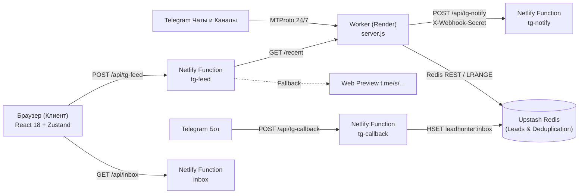

# LeadHunter Monorepo (Web App + 24/7 Telegram Worker)

Репозиторий платформы **LeadHunter** — специализированного сервиса для видеомонтажёров по поиску YouTube-клиентов и мониторингу вакансий в реальном времени.

---

## 🏛 Архитектура системы



---

## ⚙️ Переменные окружения (Environment Variables)

### 1. Telegram Worker (Render.com)

| Переменная | Обязательна | Назначение / Описание |
|---|:---:|---|
| `API_ID` | **Да** | Цифровой ID Telegram приложения из [my.telegram.org](https://my.telegram.org) |
| `API_HASH` | **Да** | 32-значный hex хэш приложения из [my.telegram.org](https://my.telegram.org) |
| `SESSION_STRING` | **Да** | Строка сессии GramJS, генерируется локально командой `npm run auth` |
| `WEBHOOK_SECRET` | **Да** | Секретный токен для защиты эндпоинтов `/recent`, `/metrics` (мин. 16 символов) |
| `WEBHOOK_URL` | Нет | URL эндпоинта отправки уведомлений (`https://<site>/api/tg-notify`). Если не задан, сбор идёт в память/recent.json |
| `ALLOWED_ORIGIN` | Нет | Домен сайта (например `https://fleurleads-work.netlify.app`) для проверки совпадения с WEBHOOK_URL |
| `ALLOW_ANY_WEBHOOK_HOST`| Нет | Флаг `1` отключает проверку совпадения домена WEBHOOK_URL с ALLOWED_ORIGIN |
| `ALLOWED_CHATS` | Нет | Белый список каналов через запятую (например `work_videoedit,kinovideojob`) |
| `ALLOWED_CHATS_FILE` | Нет | Путь к файлу белого списка (перечитывается каждые 10 минут) |
| `UPSTASH_REDIS_REST_URL`| Нет | URL базы данных Upstash Redis для дедупликации и кэша |
| `UPSTASH_REDIS_REST_TOKEN`| Нет| Токен авторизации Upstash Redis REST |
| `PORT` | Нет | Порт HTTP-сервера проверки здоровья (по умолчанию `8080`) |
| `RATE_LIMIT_PER_MINUTE` | Нет | Лимит мгновенных уведомлений в минуту (по умолчанию `5`, затем объединяются в дайджест) |
| `RENDER_EXTERNAL_URL` | Нет | Внешний URL сервиса на Render для фонового самопинга раз в 10 минут |

> 💡 **Рекомендация по бесплатному тарифу Render**:
> Бесплатные Web Services на Render засыпают при отсутствии входящих запросов через 15 минут. В `server.js` встроен автоматический самопинг (при указании `RENDER_EXTERNAL_URL`). Для 100% гарантии бодрствования рекомендуется подключить внешний пингер (например, [UptimeRobot](https://uptimerobot.com) или [cron-job.org](https://cron-job.org)) с интервалом проверки каждые 10 минут по адресу `https://<worker-host>/`.

---

### 2. Веб-приложение (Netlify)

| Переменная | Обязательна | Назначение / Описание |
|---|:---:|---|
| `APP_PASSWORD` | **Да (в prod)** | Пароль администратора для входа в веб-приложение |
| `APP_SESSION_SECRET` | Рекомендуется | Секрет подписи сессионных cookie (мин. 32 символа). Если не задан, вычисляется из `APP_PASSWORD` |
| `WEBHOOK_SECRET` | **Да** | Секретный токен для приёма лидов от воркера и callback-запросов от Telegram-бота |
| `TELEGRAM_BOT_TOKEN` | Для бота | Токен бота от [@BotFather](https://t.me/BotFather) для отправки уведомлений и обработки кнопок |
| `TELEGRAM_CHAT_ID` | Для бота | Ваш личный Telegram Chat ID для приёма лидов и кнопок отклика |
| `UPSTASH_REDIS_REST_URL`| Для воронки | URL Upstash Redis для синхронизации кнопок «В воронку» и скрытия каналов |
| `UPSTASH_REDIS_REST_TOKEN`| Для воронки| Токен доступа Upstash Redis REST |
| `TG_WORKER_URL` | Для статуса | URL воркера на Render (например `https://leadhunter-worker.onrender.com`) для индикатора статуса |
| `YOUTUBE_API_KEY` | Опционально | Ключ Google Cloud YouTube Data API v3 для поиска каналов в Lead Finder |
| `GEMINI_API_KEY` | Опционально | Ключ Google AI Studio (Gemini 2.5 Flash) для генерации питчей |
| `GROQ_API_KEY` | Опционально | Резервный AI-ключ Groq Cloud |
| `OPENROUTER_API_KEY` | Опционально | Резервный AI-ключ OpenRouter |
| `ANTHROPIC_API_KEY` | Опционально | Резервный AI-ключ Anthropic Claude |

---

## 🔍 Диагностика: почему нет вакансий

Если в ленте пусто или перестали приходить уведомления в Telegram, выполните следующие 5 шагов:

1. **Проверьте статус воркера**:
   Откройте в браузере или выполните:
   ```bash
   curl https://<worker-host>/
   ```
   Ответ должен быть HTTP 200:
   `{"status": "online", "telegram": {"connected": true, ...}}`.
   Если `connected: false` — проверьте логи воркера на Render на наличие `AUTH_KEY_UNREGISTERED` или `FLOOD_WAIT`. При необходимости перевыпустите сессию: `npm run auth`.

2. **Проверьте привязку Telegram Webhook**:
   В корне проекта выполните:
   ```bash
   npm run tg:webhook
   ```
   Скрипт выведет текущий статус вебхука бота. Убедитесь, что `pending_update_count` не завис и поле `last_error_message` пустое.

3. **Проверьте метрики и лог фильтрации воркера**:
   ```bash
   curl -H "X-Webhook-Secret: <ВАШ_СЕКРЕТ>" https://<worker-host>/metrics
   ```
   В ответе просмотрите секцию `privacyStats` и `skippedByFilter`, чтобы убедиться, что каналы опрашиваются, а вакансии не отсекаются стоп-словами.

4. **Проверьте системное здоровье в веб-приложении**:
   Откройте `https://<site>/api/health` в браузере или нажмите значок статуса в интерфейсе (SystemHealthModal). Убедитесь, что все компоненты (telegramBot, redis, worker) в статусе `ok`.

5. **Проверьте список активных каналов**:
   Запросите:
   ```bash
   curl -H "Authorization: Bearer <WEBHOOK_SECRET>" https://<site>/api/sources-enabled
   ```
   Убедитесь, что `count` больше 0 (базовый каталог содержит 223 проверенных источника EU/US/KZ).

---

## 🚀 Команды разработки

```bash
# Запуск полного набора тестов (воркер, фильтрация, аутентификация, хранилище, веб)
npm test

# Линтинг кода
npm run lint

# Проверка типов TypeScript
npm run typecheck

# Сборка веб-приложения
npm run build

# Интерактивная авторизация в Telegram (генерация SESSION_STRING)
npm run auth

# Установка Telegram Webhook для кнопок бота
npm run tg:webhook
```
